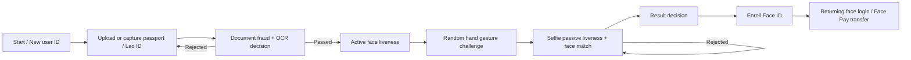

# Kyron eKYC Project Overview

Last updated: 2026-06-10

Kyron eKYC is a web-first identity verification, liveness, face-login, and payment-authorization prototype for secure document onboarding and returning-user authentication. The app is designed around a NIST IAL2-aligned flow: verify an identity document, prove the user is live, match the selfie to the document portrait, return explainable fraud-risk decisions, then optionally enroll one active Face ID for future login or Face Pay-style actions. The backend is Python/FastAPI with local and open-source model adapters; the frontend is React/Vite with camera-based capture experiences.

The project began under the LALIGENCE name and has since been re-themed toward the Kyron product identity. Some legacy files and proposal artifacts still use LALIGENCE naming, but the current app direction, logo, and white paper use Kyron.

## End-To-End Flow

## Current Build Snapshot

| Area | Current state |
| --- | --- |
| Product identity | Kyron logo/theme is now used for the current app direction; older LALIGENCE artifacts remain for reference. |
| Backend | FastAPI API with local/open-source model boundaries for document fraud, OCR, liveness, selfie, face matching, enrollment, and face login. |
| Frontend | React/Vite web app with intro page, desktop/mobile layouts, step gating, camera capture, live decision panel, and payment-style demo flow. |
| Document support | Passport and Lao ID card upload/camera flows. Passport uses MRZ/OCR; Lao ID uses visible OCR/date extraction where possible. |
| Liveness support | Active face liveness uses randomized face actions plus backend evidence bursts. Selfie passive liveness uses multi-frame bursts. |
| Face ID | One `user_id` maps to one active face template. One document number maps to one verified profile. Returning users can face-login. |
| Payment demo | Face Pay transfer flow demonstrates a payment/banking action confirmed by Face ID after enrollment. |
| Database | SQLAlchemy profile store uses PostgreSQL when `DATABASE_URL` is set and SQLite fallback locally. |
| Deployment paths | Local dev, Cloudflare tunnel for phone/team testing, Render blueprint, DigitalOcean Singapore droplet guide, and Vercel frontend config. |
| Documentation | Project overview, NIST IAL2 test plan, guidebook PDF, proposal PDF/DOCX, dataset dashboard PDF, workflow diagrams, and Kyron white paper draft. |

## What The App Can Do

| Area | Function | What it does |
| --- | --- | --- |
| Start page | New user signup | Generates or accepts a `user_id`, then creates a verification session. |
| Start page | Face login only | Lets returning users authenticate by live selfie against enrolled Face IDs. |
| Start page | Face Pay transfer demo | Shows a bank/payment-style flow where a user confirms an action with Face ID. |
| Document proofing | Passport upload/camera | Accepts JPG/PNG/WebP passport evidence from file upload or camera capture. |
| Document proofing | Lao ID card upload/camera | Supports Lao ID card evidence with Lao/English OCR paths. |
| Document proofing | OCR/MRZ extraction | Extracts passport MRZ, name, document number, nationality, birth date, and expiry. Lao ID extracts visible fields where possible. |
| Document fraud detection | Quality checks | Scores resolution, brightness, contrast, sharpness, glare, and document-likeness. |
| Document fraud detection | Fraud signals | Detects non-document uploads, expired documents, weak MRZ/OCR, recapture cues, tamper cues, portrait substitution risk, and printed-copy-on-paper risk. |
| Active liveness | Face action challenge | Uses browser MediaPipe Face Mesh to detect actions like turn left, turn right, blink, and open mouth. |
| Active liveness | Replay defense | Sends short evidence bursts to the backend, where face detection and passive spoof checks reject strong screen/photo/replay evidence. |
| Hand gesture | Random gesture challenge | Picks 3 random gestures from a 23-gesture set and requires the hand inside a random on-screen circle. Sampling is easy-weighted: at least 2 of the 3 gestures come from the easy pool, and at most one tricky gesture (rock on, call me, I love you, thumb down, crossed fingers) appears per session. |
| Hand gesture | Full-screen camera | Opens a front-camera full-screen challenge view and auto-passes when the correct gesture is held. Challenge cards and the full-screen view show the gesture visual plus a per-gesture how-to instruction. |
| Selfie | Passive liveness | Captures a 10-frame live burst and uses anti-spoofing models plus heuristics to detect screen, phone, tablet, paper photo, glare, moire, and printed-photo attacks. |
| Selfie | Face matching | Compares the live selfie face embedding against the document portrait embedding using OpenCV YuNet + SFace. |
| Result | Live decision panel | Shows decision, reason codes, document quality, fraud risk, face match, passive risk, selfie quality, and OCR summary. |
| Enrollment | Face ID storage | After a passed session, stores one active face template per `user_id` and one verified profile per document number. |
| Returning user | Face login | Captures a live selfie, checks passive liveness, matches against stored templates, and returns the verified profile. |
| Testing tools | Dataset installers/evaluators | Provides scripts for document fraud datasets, selfie spoof datasets, active liveness datasets, print-copy testing, NIST-style test cases, and local camera dataset capture. |

## Main Backend Components

| Module | Responsibility |
| --- | --- |
| `backend/app/api/routes.py` | FastAPI endpoints for sessions, document upload, active liveness evidence, hand challenges, selfie analysis, face enrollment, profile admin, and face login. |
| `backend/app/services/session_store.py` | In-memory verification session state, random active/hand challenges, step completion rules, final decision logic, and temporary document/selfie embeddings. |
| `backend/app/services/fraud.py` | Document analysis pipeline: image loading, quality, document-likeness, OCR/MRZ, Lao ID OCR, forensics, risk scoring, and final document pass/reject. |
| `backend/app/services/document_models.py` | Model-style fraud adapters for document liveness, print-copy detection, tamper risk, portrait substitution, and ensemble scoring. |
| `backend/app/services/face_biometrics.py` | YuNet face detection, SFace embeddings, face comparison, ONNX passive anti-spoof models, and screen/paper spoof heuristics. |
| `backend/app/services/selfie.py` | Selfie quality scoring, passive liveness aggregation, face-match thresholding, and selfie reason codes. |
| `backend/app/services/profile_store.py` | SQLAlchemy profile store with SQLite local fallback and PostgreSQL deployment support. Stores face templates and verified profile fields. |
| `backend/app/core/config.py` | Environment-driven thresholds, database URL, CORS origins, upload limits, model behavior, and rate settings. |

## Main Frontend Components

| File | Responsibility |
| --- | --- |
| `frontend/src/App.tsx` | Main app shell, intro page, workflow routing, step gating, API calls, notices, result panel, face login, and payment demo screens. |
| `frontend/src/components/CameraCapture.tsx` | Reusable camera capture for document and selfie steps; uses back camera for document capture and front camera for face capture. |
| `frontend/src/components/ActiveLivenessCapture.tsx` | Face Mesh active liveness detection, challenge auto-pass, local/CDN MediaPipe fallback, and evidence capture. |
| `frontend/src/components/HandGestureCapture.tsx` | MediaPipe Hands gesture recognition, random target circle, gesture hold progress, and full-screen interaction. |
| `frontend/src/lib/api.ts` | Typed API client with retries, timeouts, upload helpers, and normalized network errors. |
| `frontend/src/lib/image.ts` | Client-side image optimization before upload. |
| `frontend/src/lib/camera.ts` | Camera support and permission error messaging. |

## Testing And Dataset Structure

| Dataset area | Path | Purpose |
| --- | --- | --- |
| General document fraud | `test_dataset/` | Genuine and fraud folders for upload-route accuracy, fraud signals, MRZ/OCR behavior, and false reject / false accept reporting. |
| Print-copy detection | `test_dataset/document_print_copy/` | Real camera passport/Lao ID vs printed paper, photocopy, scan, and screen-display document attacks. |
| Selfie passive liveness / face match | `test_dataset/selfie_passive_liveness_face_login/` | Real live match/nonmatch, fake phone screen, tablet/laptop screen, video replay, printed photo, paper mask, multiple faces, and no-valid-face cases. |
| Active liveness | `test_dataset/active_liveness/` | Real live face, glasses, poor lighting, phone/tablet/laptop replay, printed photo, and video replay closeup cases. |
| Face login | `test_dataset/face_login/` | Enrolled real live, enrolled spoof, unknown live, unknown spoof, multiple faces, and no-valid-face cases. |
| Selfie spoof public samples | `test_dataset/selfie_spoof/` | AxonData/Hugging Face-derived screen replay, print/paper, mask/cutout, and user-provided live samples. |
| Lao ID card datasets | `test_dataset/lao_id_card/` | Roboflow-style document and field detection datasets when available through API-key access. |

Useful scripts:

- `scripts/capture_selfie_dataset.py`: browser-based camera collector with main-folder and nested-label selection, countdown capture, and auto-save.
- `scripts/install_test_dataset.py`: seeds local document cases and prepares IDNet/MIDV-style document datasets.
- `scripts/install_selfie_spoof_dataset.py`: installs public selfie spoof samples and larger extracted frame sets.
- `scripts/import_selfie_liveness_dataset.py`: imports collected selfie/liveness images into the expected folder structure.
- `backend/scripts/evaluate_document_fraud.py`: reports document fraud accuracy, false reject rate, false accept rate, precision, recall, and mistakes.
- `backend/scripts/evaluate_document_upload.py`: tests the real FastAPI document upload route against a dataset.
- `backend/scripts/evaluate_selfie_spoof.py`: reports selfie passive anti-spoof accuracy and per-folder mistakes.
- `scripts/evaluate_document_print_copy_dataset.py`: evaluates real camera document captures vs printed/screen/photocopy attacks.
- `scripts/evaluate_active_liveness_dataset.py`: runs the full server-side active-liveness pipeline (face extract + PAD model + face-size and replay gate) over any `test_dataset/active_liveness/` folder, grouped into 3-frame bursts, and reports per-folder detection / false-accept / false-reject rates.
- `scripts/build_results_slide_pdf.py`: builds the one-page results slide (`docs/results-slide.pdf` / `.png`) using the Kyron brand, with editable accuracy figures in the `RESULT_CARDS` list.
- `scripts/build_combined_pitch_deck.py`: merges the pain-point and solution decks and adds a cover/agenda slide plus a results slide into one branded deck at `docs/Kyron_eKYC_Pitch.pptx`.

## Data And Storage

The backend does not store raw uploaded passport, Lao ID, selfie, or liveness images during normal verification. **Exception — border/immigration deployments:** when `LALIGENCE_EVIDENCE_ENABLED` is set (off by default), the system retains the frames from every step, an action timeline, and an access log for each crossing, as required of an official system of record. Frames are downscaled, encrypted at rest, and expire after `LALIGENCE_EVIDENCE_RETENTION_DAYS` (default 1825 = 5 years); the crossing metadata is retained unless `LALIGENCE_EVIDENCE_PURGE_METADATA` is also set. Every view of a traveller's evidence is recorded. It temporarily holds document and selfie face embeddings inside the active session. After a passed verification, Face ID enrollment stores a verified profile with `user_id`, `face_id`, document number, name fields, nationality, birth date/age, expiry date, and the face template. Local development uses SQLite at `backend/data/laligence_profiles.sqlite3`; deployed environments can use PostgreSQL through `DATABASE_URL`.

## Documents And Deliverables

| Artifact | Path | Notes |
| --- | --- | --- |
| NIST IAL2 test case plan | `docs/nist-ial2-test-case-plan.md` | Scenario-style test cases for IAL2-style proofing and attack coverage. |
| Combined pitch deck | `docs/Kyron_eKYC_Pitch.pptx` / `.pdf` | Six-slide deck: cover/agenda, pain point (x2), solution (x2), and results. Rebuilt by `scripts/build_combined_pitch_deck.py`. |
| Results slide | `docs/results-slide.pdf` / `.png` | One-page validated-results slide (document and liveness accuracy). Rebuilt by `scripts/build_results_slide_pdf.py`. |
| System workflow one-pager | `docs/system-workflow.pdf` / `.png` | End-to-end verification flow on a single page. |
| Dataset result dashboard | `docs/dataset-result-dashboard.pdf` | One-page PDF dashboard summarizing dataset/pass-fail testing direction. |
| Kyron white paper draft | `docs/kyron-ekyc-nist-ial2-white-paper-draft.docx` | NIST IAL2-aligned white paper draft with ISO/FATF references and roadmap. |
| Project overview PDF | `docs/project-overview.pdf` | Shareable PDF overview generated from this project summary. |
| Guidebook PDF | `docs/guidebook/LALIGENCE_eKYC_Guidebook.pdf` | Workflow guidebook for colleagues and customer walkthroughs. |
| Proposal deck/document assets | `outputs/project_proposal/` | Proposal PDF/DOCX and screenshots for each app page. |
| Workflow diagrams | `docs/laligence-ekyc-workflow.drawio`, `docs/laligence-simple-end-to-end-workflow.drawio` | Detailed and simplified process diagrams. |

## Current Security Scope

The prototype supports explainable local fraud signals, passive and active liveness, face matching, user/profile uniqueness rules, PostgreSQL-backed profiles, and growing test datasets. For production or formal certification, the remaining hardening work is encrypted biometric-template storage, consent and retention controls, authenticated admin APIs, audit logging, stronger document/anti-spoof model validation, calibrated thresholds from larger datasets, manual review/redress, MFA for high-risk payment flows, and independent security/privacy review.

Recommended wording for external discussions: Kyron is **designed toward NIST IAL2 alignment**. Do not claim NIST certification, ISO certification, bank-grade certification, or government approval unless an independent assessment has been completed.

## Recent Updates So Far

- Re-themed the current product direction around the Kyron identity and logo.
- Added Lao ID card upload/OCR support alongside passport proofing.
- Added Face Pay transfer demo flow for payment-style face authorization.
- Added one-user-to-one-active-Face-ID and one-document-number-to-one-verified-profile enrollment rules.
- Moved face profile storage to SQLAlchemy with PostgreSQL support and SQLite local fallback.
- Added multi-frame selfie burst analysis for passive liveness and screen/tablet/printed-photo replay defense.
- Added backend-verified active liveness evidence bursts so face actions are not trusted from frontend landmarks alone.
- Expanded hand gesture challenge to a simple 20-gesture set with randomized full-screen target placement.
- Expanded the gesture set to 23 with L shape, pinched fingers, and crossed fingers, plus easy-weighted sampling so each session contains at most one tricky gesture.
- Gesture challenge cards and the full-screen camera now show each gesture's visual and specific how-to instruction instead of generic text.
- Added a user-facing hand gesture guide as `docs/hand-gesture-guide.md` with branded PDF/PNG exports built by `scripts/build_hand_gesture_guide_pdf.py` (headless Chrome rendering).
- Added print-copy document testing folders for real camera captures vs printed paper, photocopy/scan, and screen-display attacks.
- Added selfie, active liveness, and face-login dataset folder structures for accuracy testing.
- Added browser-based dataset capture tooling with folder selection and countdown capture.
- Added dataset dashboard PDF, NIST IAL2 test case plan, project guidebook, proposal screenshots, and Kyron/NIST white paper draft.
- Added `scripts/evaluate_active_liveness_dataset.py` and validated the active-liveness anti-spoof gate on collected attacks: `fake_printed_photo` (120 images / 40 bursts) and `fake_phone_screen_replay` (50 images / 17 bursts) were rejected at 100% with 0% false-accept; rejection is driven by the small-face gate plus the recurring PAD-model vote.
- Verified non-document upload handling on the document route: selfies, screenshots, phone-screen photos, PDFs, empty files, oversized files, unknown document types, and corrupt bytes are all rejected with clear reason codes (MRZ hard-fail or route-level guards) rather than crashing.
- Added the one-page results slide (`docs/results-slide.pdf` / `.png`) and the combined six-slide pitch deck (`docs/Kyron_eKYC_Pitch.pptx`), both on the Kyron brand. Headline accuracy figures (95.7% document, 96.4% liveness) are current target/operating-point estimates pending a larger labelled validation set, not yet a completed 10k-per-category study.

